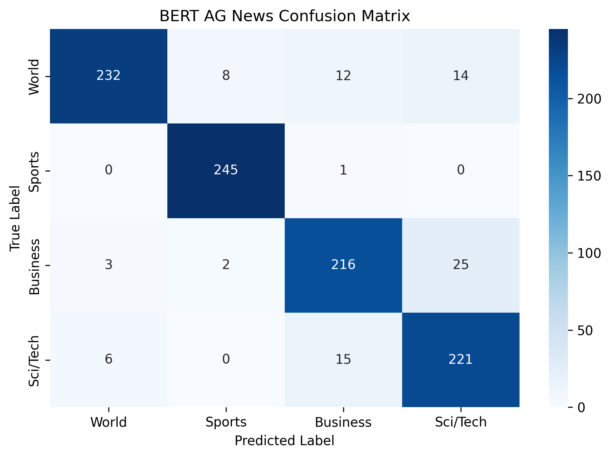

# BERT Multi-Class News Classification

Fine-tuning BERT for news classification using PyTorch and Hugging Face.

## Dataset
AG News: World, Sports, Business, Sci/Tech.

## Model
- bert-base-uncased
- Training samples: 8,000
- Validation samples: 1,000
- Test samples: 1,000
- Epochs: 2
- GPU: NVIDIA Tesla T4

## Results
- Validation Accuracy: 93.1%
- Test Accuracy: 91.4%
- Training Time: 187 seconds

## Confusion Matrix

## Example Prediction
Input: NASA announces a new mission to explore Mars.

Prediction: Sci/Tech

Softmax confidence: 97.49%

## Technologies
Python, PyTorch, Transformers, Hugging Face,
scikit-learn, pandas, Matplotlib, Google Colab.

## Usage
Install dependencies:

    pip install -r requirements.txt

Place the fine-tuned model files in bert-ag-news-model/,
then run:

    python predict.py
